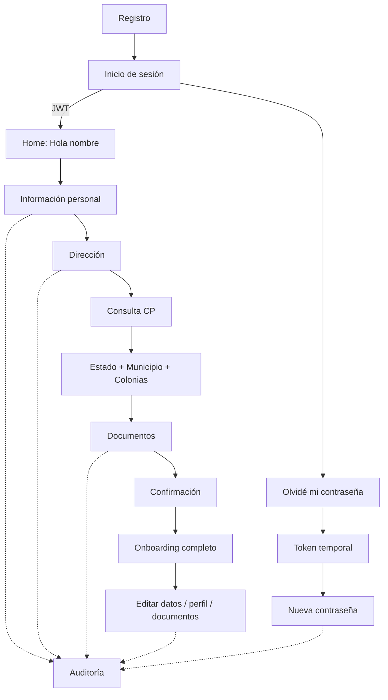

# Procedimiento y diagrama de flujo

1. El cliente crea una cuenta con nombre, correo y contraseña.
2. Inicia sesión y recibe un JWT temporal.
3. El Home muestra `Hola, {nombre_usuario}` y el avance del onboarding.
4. Captura información personal; el backend valida y cifra los campos sensibles con AES-256-GCM.
5. Captura CP. El backend devuelve estado, municipio y colonias; 91810 cuenta con respaldo local para la demostración.
6. Captura calle/número y selecciona colonia.
7. Carga documentos PDF/JPG/PNG; se cifran antes de persistirse y pueden previsualizarse.
8. Cada acción relevante registra user id, acción, IP y timestamp.
9. El usuario puede volver después a editar datos, perfil, contraseña o documentos.
10. Si olvida la contraseña, solicita un token temporal de recuperación y define una nueva.

