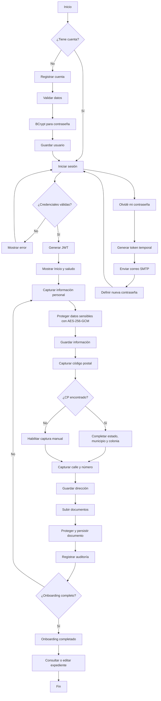

# Procedimiento para completar la actividad — Sistema de Onboarding Digital

## 1. Objetivo

Implementar un proceso de incorporación digital que permita crear una cuenta, autenticarse, capturar información personal y dirección, administrar documentos, proteger información sensible y mantener trazabilidad de las operaciones.

## 2. Tecnologías utilizadas

- Backend: Java 17 + Spring Boot 3.
- Frontend: React.
- Base de datos: PostgreSQL.
- Persistencia: Spring Data JPA.
- Autenticación: JWT.
- Contraseñas: BCrypt.
- Cifrado de datos sensibles: AES-256-GCM.
- Pruebas: JUnit 5 + Mockito.
- Cobertura: JaCoCo.
- Contenedores: Docker y Docker Compose.

## 3. Ejecución del sistema

Desde la raíz del proyecto:

```bash
docker compose up --build
```

Docker inicia PostgreSQL, el backend Spring Boot y el frontend React. PostgreSQL utiliza un volumen persistente para conservar los datos entre reinicios normales.

> No utilizar `docker compose down -v` si se desea conservar la información, ya que `-v` elimina el volumen de PostgreSQL.

## 4. Registro y autenticación

1. El usuario crea una cuenta indicando nombre, correo y contraseña.
2. El backend valida la información.
3. La contraseña se procesa con BCrypt antes de almacenarse.
4. El usuario inicia sesión con correo y contraseña.
5. Si las credenciales son correctas, el backend genera un JWT.
6. El JWT autoriza las solicitudes protegidas posteriores.
7. En Inicio se presenta el saludo `Hola, {nombre_usuario}`.

## 5. Información personal

En **Mis datos**, el usuario captura nombre, teléfono celular y número de identificación. La información sensible se protege con AES-256-GCM antes de persistirse. El expediente puede modificarse posteriormente.

## 6. Dirección

1. El usuario captura el código postal.
2. El sistema intenta obtener estado, municipio y colonia/localidad.
3. Si el CP existe en el catálogo disponible, los datos se completan automáticamente.
4. Si no se encuentra, se habilita captura manual para no bloquear el onboarding.
5. El usuario captura calle y número.
6. La dirección se almacena asociada a la cuenta autenticada.

## 7. Documentos

La sección **Documentos** permite trabajar con PDF, JPG y PNG. El usuario puede subir, visualizar, descargar, reemplazar y eliminar documentos. El contenido se protege antes de persistirse y la eliminación utiliza baja lógica. Las operaciones de documentos son independientes del perfil y no deben modificar información personal ni dirección.

## 8. Auditoría y trazabilidad

Las operaciones relevantes generan registros que incluyen identificador del usuario, acción realizada, dirección IP y fecha/hora. Esto permite consultar actividad de registro, inicio de sesión, cambios de información y operaciones con documentos.

## 9. Recuperación de contraseña

1. El usuario selecciona la opción de recuperación.
2. Captura su correo registrado.
3. El backend genera un token temporal de un solo uso.
4. Se envía el enlace mediante la configuración SMTP.
5. El usuario establece una nueva contraseña.
6. La nueva contraseña vuelve a almacenarse mediante BCrypt.

## 10. Administración

Los endpoints administrativos están restringidos al rol `ADMIN`. El panel permite consultar usuarios, expedientes, documentos, auditoría y métricas; administrar otros usuarios ADMIN; y configurar/probar SMTP. El correo remitente y el correo utilizado para pruebas son independientes.

## 11. Persistencia

PostgreSQL mantiene los datos de la aplicación. Docker Compose utiliza un volumen persistente, por lo que el reinicio normal se realiza con:

```bash
docker compose down
docker compose up --build
```

## 12. Pruebas unitarias y cobertura

Las pruebas utilizan JUnit 5, Mockito y JaCoCo. Desde `backend` se ejecuta:

```powershell
docker run --rm -v "${PWD}:/app" -w /app maven:3.9-eclipse-temurin-17 mvn clean verify
```

El reporte se abre con:

```powershell
start .\target\site\jacoco\index.html
```

En la verificación realizada para esta entrega se obtuvo **94% de cobertura de instrucciones** y **66% de ramas**, superando el mínimo de 60%.

## 13. Diagrama de flujo



## 14. Flujo resumido de datos

```text
React -> API REST Spring Boot -> Service -> Repository JPA -> PostgreSQL
                    |                |
                    |                +-> Auditoría
                    +-> JWT / BCrypt / AES-256-GCM
```

## 15. Resultado esperado

Al finalizar, el cliente dispone de una cuenta autenticada, información personal y dirección persistidas, documentos asociados y un historial de auditoría. La información sensible se protege y el expediente puede editarse posteriormente. El administrador puede supervisar el proceso desde su panel.
